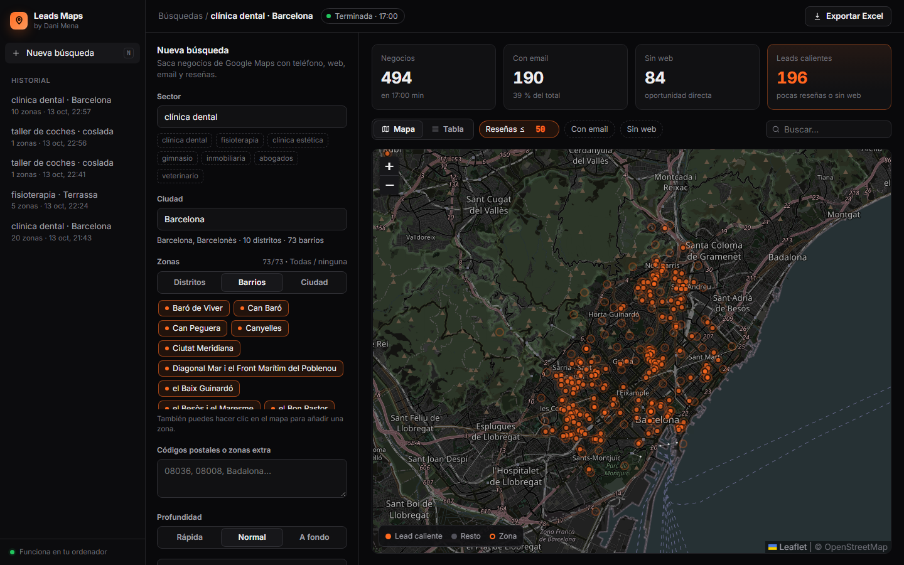

# Leads Maps

Saca negocios de **Google Maps** con su **teléfono, web, email y reseñas**, desde una interfaz web en tu ordenador. Eliges el sector, la ciudad y los barrios (o códigos postales), y ves cómo van apareciendo en un mapa y en una tabla. Al final lo descargas en Excel.

Pensado para agencias y freelancers de marketing que buscan clientes: filtra los **leads calientes**, negocios con **pocas reseñas** o **sin web**, que son los que más necesitan ayuda.



## Qué hace
- **Cualquier ciudad de España:** carga sola sus distritos y barrios (OpenStreetMap). También puedes escribir códigos postales o hacer clic en el mapa para añadir una zona.
- **Mapa en directo:** radar sobre la zona, barrios escaneándose y chinchetas que caen según salen negocios.
- **Filtros:** reseñas máximas, con email, sin web y buscador.
- **Exportar a Excel** con el filtro aplicado.
- **Skill para Claude Code:** pídele «sácame las clínicas dentales de Gràcia con pocas reseñas» y usa esta misma herramienta.

## Requisitos
- [Node.js](https://nodejs.org) 20 o superior.
- [Docker Desktop](https://www.docker.com/products/docker-desktop/) abierto.

## Instalación rápida con Claude Code
Pega esto en Claude Code:

```
Instálame Leads Maps desde https://github.com/daniemen2388/leads-maps:
1. Comprueba que tengo Node.js 20+ y Docker Desktop en marcha (si falta algo, dime cómo instalarlo).
2. Clona el repositorio en una carpeta de herramientas.
3. Descarga la imagen: docker pull gosom/google-maps-scraper
4. Copia la carpeta skill/leads-maps a mi carpeta de skills de Claude (~/.claude/skills/).
5. Arranca el servidor con npm start y ábreme http://localhost:4580
```

## Instalación manual
```bash
git clone https://github.com/daniemen2388/leads-maps.git
cd leads-maps
docker pull gosom/google-maps-scraper
npm start
```
Abre http://localhost:4580. En Windows también puedes hacer doble clic en `Abrir Leads Maps.cmd`.

## Cómo se usa
1. Escribe el **sector** (clínica dental, fisioterapia, gimnasio…) y la **ciudad**.
2. Elige **distritos**, **barrios** o **toda la ciudad**. Añade códigos postales si quieres.
3. Elige la profundidad (rápida, normal o a fondo) y si quieres buscar emails.
4. Dale a **Buscar negocios** y míralo en el mapa.
5. Filtra y pulsa **Exportar Excel**.

Una búsqueda de 20 barrios en profundidad normal tarda unos 15–20 minutos.

## Si Docker falla en Windows
Si la app dice «Docker no está en marcha» con Docker abierto:
- Desactiva el **Resource Saver** en Docker Desktop (Settings → Resources).
- Ejecuta `powershell -ExecutionPolicy Bypass -File reiniciar-docker.ps1`.

## Ten en cuenta
- Algunos emails pueden ser de la agencia que hizo la web del negocio: revísalos antes de escribir.
- Usa los datos con cabeza y respeta las normas de cada plataforma.

## Créditos
- Extracción de Google Maps: [gosom/google-maps-scraper](https://github.com/gosom/google-maps-scraper) (MIT).
- Mapas y barrios: © [OpenStreetMap](https://www.openstreetmap.org/copyright).

Hecho por **Dani Mena**. Más herramientas de IA para marketing en Instagram: [@danimen___](https://www.instagram.com/danimen___/).
